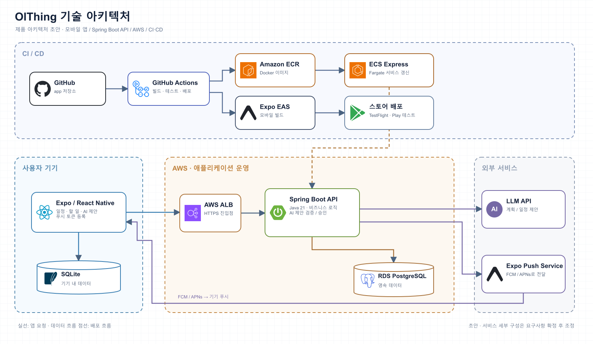

# OlThing

### 복잡한 하루를 실행 가능한 계획으로

**OlThing은 일정과 할 일을 한곳에 모으고, AI의 제안을 사용자가 확인하고 승인해 계획으로 만드는 모바일 앱입니다.**

`제품 설계 중` · `모바일 앱` · `개인 일정과 할 일`

## 어떤 경험을 만들고 있나요?

| 기능 | 경험 |
| --- | --- |
| 🗓️ Today · Calendar | 오늘의 고정 일정과 할 일, 주간 계획을 함께 봅니다. |
| ✅ Task · Goal | 할 일을 목표에 연결하고 진행 상태와 예상 시간을 관리합니다. |
| ✨ AI 제안 | 자연어로 할 일이나 일정을 입력하고, 한 주의 빈 시간에 작업 블록을 제안받습니다. |
| 👀 미리보기와 승인 | AI가 바꿀 내용을 먼저 비교합니다. 사용자가 승인하기 전에는 일정이 변경되지 않습니다. |
| 📱 로컬 우선 편집 | 인터넷이 없어도 수동으로 편집하고, 연결되면 변경을 동기화합니다. |
| 🔔 푸시 알림 | Expo Push Service를 통해 모바일 알림을 전달하는 방향으로 설계하고 있습니다. |

> **현재는 구현 전 설계 단계입니다.** 위 기능은 출시된 기능 목록이 아니라 제품 목표입니다. MVP와 V1의 범위는 [요구사항 문서](https://github.com/OlThing/docs/blob/main/requirements-v1.md)에서 관리합니다.

## 기술 아키텍처

  

<a href="assets/olthing-system-architecture.drawio">편집 가능한 draw.io 원본</a>

| 영역 | 설계 방향 |
| --- | --- |
| 모바일 | Expo · React Native · SQLite |
| 서버 | Java 21 · Spring Boot |
| 인프라 | AWS ALB · ECS Express/Fargate · RDS PostgreSQL |
| AI · 알림 | LLM API · Expo Push Service → FCM/APNs |
| CI/CD | GitHub Actions · Docker · Amazon ECR · Expo EAS |

아키텍처는 구현 전 초안이며 요구사항과 운영 조건을 확정하면서 조정합니다.

## 개발 저장소

- [OlThing/olthing](https://github.com/OlThing/olthing) — 앱과 서버 코드
- [OlThing/docs](https://github.com/OlThing/docs) — 요구사항과 설계 문서

두 저장소는 팀 전용일 수 있어 접근 권한이 필요합니다.
